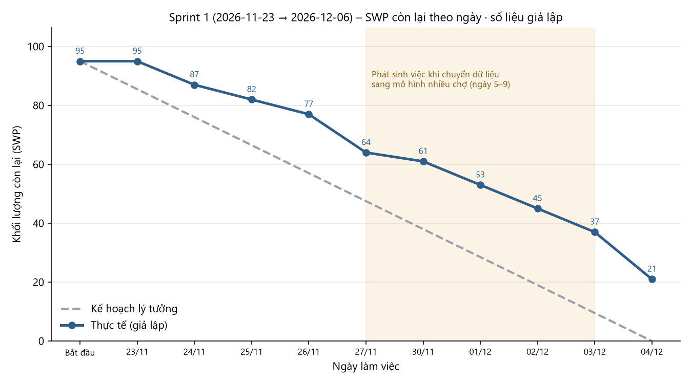

# Báo cáo tiến độ – Product A

## 1. Thông tin chung

| | |
|---|---|
| Iteration trên Project | **Sprint 1** (Project "Product A – LAB-5 Backlog") |
| Thời gian | 2026-11-23 → 2026-12-06 (10 ngày làm việc) |
| Ngày lập báo cáo | 2026-11-18 – báo cáo cho thời điểm kết thúc Sprint 1 |
| Lưu ý | **Số liệu giả lập phục vụ LAB-5**, không phải tiến độ thực tế của dự án |

Đơn vị khối lượng: **SWP** (điểm khối lượng công việc đã được rà soát; 1 SWP ≈ 2 giờ làm việc). Số issue (#) là số trên kho quản lý công việc của dự án.

---

## 2. Trạng thái

Sprint 1 lập kế hoạch **23 issue / 95 SWP** (208 giờ, bằng 80% năng lực đội 260 giờ). Hoàn thành **74 SWP (78%)**.

| Trạng thái | Số issue | Tổng SWP | Ghi chú |
|---|---|---|---|
| Done | 17 | 74 | Nền tảng dự án (CI, môi trường, quy trình cập nhật database), chặn sửa / xóa lưu vết, bảng chợ, một phần chuyển dữ liệu sang mô hình nhiều chợ, bảng quy tắc vận hành, bảng phân quyền nhiều vai trò, bộ kiểm thử hồi quy tự động, thử nghiệm kỹ thuật chế độ mất mạng trên tablet. Đã đóng issue. |
| In Review | 1 | 3 | Lịch ngày chợ nghỉ (#37): đã nhận trả lời, đang ghi thành quyết định chính thức. |
| In Progress | 1 | 8 | Cập nhật chức năng đọc / ghi theo chợ (#29): bắt đầu trễ, còn khoảng 40%. |
| Blocked | 3 | 7 | Chờ Quý khách trả lời: nguồn lập 請求 (#151), mẫu file CSV kế toán (#133), thời gian dùng tablet khi mất mạng (#170). |
| Todo | 1 | 3 | Kiểm thử chức năng theo chợ (#30): chờ #29. |
| **Tổng** | **23** | **95** | 6 issue chưa xong chuyển sang Sprint 2. |

**完納奨励金:** trong Sprint 1 chỉ có 1 việc – làm rõ nguồn lập 請求 (#151) – đang **chờ Quý khách trả lời**. Phần xây dựng (66 SWP) bắt đầu từ Sprint 2–3; nền cần trước đã xong một phần (bảng quy tắc vận hành có phiên bản).

---

## 3. Burndown

| Ngày | Kế hoạch lý tưởng (SWP còn lại) | Thực tế (SWP còn lại) | Chênh |
|---|---|---|---|
| Bắt đầu | 95,0 | 95 | 0,0 |
| 23/11 | 85,5 | 95 | +9,5 |
| 24/11 | 76,0 | 87 | +11,0 |
| 25/11 | 66,5 | 82 | +15,5 |
| 26/11 | 57,0 | 77 | +20,0 |
| 27/11 | 47,5 | 64 | +16,5 |
| 30/11 | 38,0 | 61 | +23,0 |
| 01/12 | 28,5 | 53 | +24,5 |
| 02/12 | 19,0 | 45 | +26,0 |
| 03/12 | 9,5 | 37 | +27,5 |
| 04/12 | 0,0 | 21 | +21,0 |

**Lệch kế hoạch ở đâu, vì sao:**
- **Ngày đầu không có việc hoàn tất** – tuần đầu dành cho dựng môi trường và CI; việc đầu tiên xong vào ngày 2. Đây là độ trễ bình thường của sprint đầu.
- **Ngày 5–9 (27/11 → 03/12): phát sinh việc khi chuyển dữ liệu sang mô hình nhiều chợ.** Dữ liệu cũ có một số dòng lịch sử đăng nhập không xác định được chợ và dữ liệu thử nghiệm còn sót. Đội phải thêm bước làm sạch và quy tắc riêng cho các dòng này: mất khoảng 18 giờ thay vì 10 giờ. Việc cập nhật chức năng theo chợ (#29) vì vậy bắt đầu trễ 3 ngày và chưa xong.
- **Câu hỏi gửi Quý khách ngày 24/11 (5 câu):** đã nhận 2 trả lời (ngày 30/11 và 02/12); 3 câu còn chờ. Ba việc làm rõ tương ứng chưa hoàn tất được, chiếm 7 SWP.
- Không có việc nào bị bỏ; khối lượng còn lại 21 SWP chuyển sang Sprint 2.

**Velocity Sprint 1: 74 SWP** (≈ 158 giờ theo ước lượng). Kế hoạch Sprint 2 sẽ dùng mức này làm trần.

---

## 4. Rủi ro trễ

| Rủi ro | Issue (#số) | Ảnh hưởng tới mốc nào | Hành động | Ai làm (vai giả định), khi nào |
|---|---|---|---|---|
| Chưa rõ ai lập 請求 và 請求金額 tính từ đâu | #151 (epic 完納奨励金 #136) | Sprint 2–3 (phần ghi 入金日 #141 và tính thưởng #137); **UAT** 完納奨励金 | Nhắc lại câu hỏi kèm 2 phương án đề xuất; nếu chưa có trả lời trước hạn, chốt phương án tạm và ghi rõ giả định | BrSE gửi nhắc 07/12; PL chốt phương án tạm 11/12 |
| Chưa có mẫu file CSV cho phần mềm kế toán | #133 → #134 | Sprint 3; **UAT** xuất CSV | Xin file mẫu và bảng mã ký tự; trong thời gian chờ giữ định dạng CSV hiện có | BrSE 07/12 |
| Chưa chốt thời gian dùng tablet khi mất mạng và tablet dùng chung / riêng; trình duyệt Safari trên iPad giữ dữ liệu tạm kém hơn dự kiến | #170, #155, #156 → #158, #161 | Sprint 3–4; **UAT** trên tablet; **go-live** nếu dùng iPad | Đưa câu hỏi thiết bị vào buổi họp tuần; chuẩn bị 2 phương án (khuyến nghị trình duyệt Chrome trên tablet, hoặc giới hạn thời gian mất mạng) | PL + BrSE họp 09/12; FE-1 đề xuất phương án 11/12 |
| Chuyển dữ liệu sang mô hình nhiều chợ kéo dài, đẩy lùi các việc phụ thuộc | #29, #30 (thuộc #13) → #33, #20 | **Sprint 2**: ngày làm việc theo cấu hình chợ (#33), phân quyền (#20) | Ưu tiên hoàn tất #29 trong 3 ngày đầu Sprint 2, kiểm thử #30 ngay sau; giữ 10% năng lực dự phòng | BE-2, QA-1 từ 07/12 |
| Lịch ngày chợ nghỉ chưa ghi thành quyết định | #37 → #33 | **Sprint 2** | Ghi quyết định đã nhận vào tài liệu tiền đề; cập nhật quy tắc tính ngày | PL 08/12 |
| Đầu mối hỏi đáp với Quý khách đã dùng hết năng lực | — | Sprint 2, **UAT** | Gom câu hỏi 1 lần / tuần; PL nhận các câu hỏi nội bộ | PL từ 07/12 |
